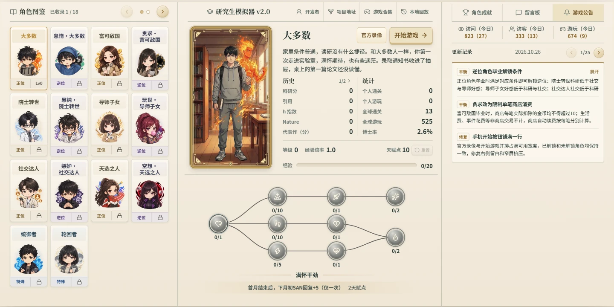
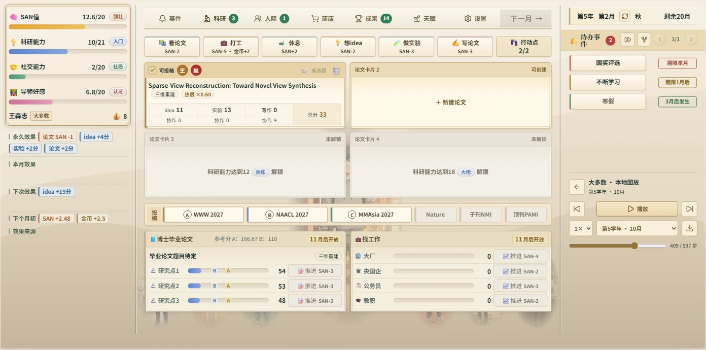

# 🎓 研究生模拟器 v2.0

**这个月，是再写一篇论文，还是先让自己好好休息？**

一款按月推进的研究生生活模拟游戏。从联系导师、进入实验室，到论文投稿、转博、毕业与求职，在有限的行动点、SAN 和金币之间，走出自己的研究生生涯。

[🎮 开始游戏](https://kw66.github.io/PhD_Simulator_V2/) · [▶ 官方教学录像](https://kw66.github.io/PhD_Simulator_V2/?replay=official) · [🐛 问题反馈](https://github.com/kw66/PhD_Simulator_V2/issues) · [📚 体验 V1](https://kw66.github.io/PhD_Simulator/) · [🕹️ 游戏合集](https://kw66.github.io/games/)

<p align="center">
  <a href="https://kw66.github.io/PhD_Simulator_V2/">
    
  </a>
</p>

**18 位角色 · 分支天赋树 · 硕士与博士路线 · 179 个成就 · 36 局官方教学录像**

支持电脑和手机浏览器，无需下载安装或注册账号。当前版本已接近正式版，持续完善角色平衡、事件与交互体验；最新变化可在游戏内「游戏公告」查看。

## 📷 游戏一览

角色图鉴、人物立绘与天赋树：选择不同起点，也选择不同的成长方式。



科研界面实录：论文进度、个人状态、待办期限和长期成长，都需要一起考虑。下图来自可直接观看的官方示范局。



## 🌱 第一次游玩

1. **从「大多数」开始。** 查看角色特性，分配开局天赋；入学后本局加点固定。
2. **联系导师，安排每个月。** 先看待办期限与下月初效果，再分配科研、人际、打工和休息所需的资源。
3. **规划毕业路线。** 科研能力影响研究过程，科研分来自论文成果；选择硕士毕业或继续攻读博士，为对应的毕业论文与盲审做好准备。
4. **结算后开启下一局。** 在结局点击「结算并返回」，确认本局经验、成就与角色进度，再尝试新的天赋或角色。

遇到困难，可以先看开始游戏按钮左侧的「官方录像」。不必照搬每一步，重点观察加点、资源安排、投稿节奏和毕业准备。

## 🧠 系统与玩法

| 系统 | 可以做些什么 |
| --- | --- |
| 📅 月度生涯 | 分配行动点，处理有期限的待办事件，通过时间轴回看经历与 SAN 变化 |
| 🔬 论文研究 | 积累 idea、实验、写作与协作分数，选择会议或期刊，经历审稿、修改、录用和拒稿 |
| 📈 科研成果 | 发表论文、积累科研分与引用、宣传代表作，争取 Best Paper、顶刊与国家奖学金 |
| 👨‍🏫 导师与项目 | 推进横向、纵向项目，争取指导和报销；经费、工资、实验与发表支出共同影响实验室运转 |
| 🤝 同学与恋人 | 同学独立研究、投稿、互助和推进学业；与恋人一起玩耍、学习或购物，积累相处进度 |
| 🛍️ 设备与日常 | 升级工位、购买生活用品、使用咖啡与 AI；阅读、打工、运动和参会等经历带来长期成长 |
| 🎲 校园事件 | 经历实习、联培、恋爱、学术竞争与生活插曲，在多幕事件中作出选择并承担结果 |
| 🎓 毕业与就业 | 推进毕业论文与专家盲审，在大厂、央国企、公务员、教职四条赛道准备招聘、比较 offer |
| 🏅 多局成长 | 收集成就、提升角色等级、尝试分支天赋，逐步解锁逆位、诅咒与特殊角色 |

## 🎭 18 位角色，多种成长方式

| 类别 | 角色 | 玩法特点 |
| --- | --- | --- |
| 正位 · 6 位 | 大多数、富可敌国、院士转世、社交达人、导师子女、天选之人 | 围绕行动、财富、科研、人际、导师资源与属性成长，构建不同的天赋路线 |
| 逆位 · 6 位 | 怠惰·大多数、贪求·富可敌国、愚钝·院士转世、嫉妒·社交达人、玩世·导师子女、空想·天选之人 | 限制与特殊优势并存，重新思考资源分配与成长节奏 |
| 诅咒 · 4 位 | 体弱多病、有限人生、天才迟暮、寒门负重 | 不使用天赋点，提供简单、中等、困难、地狱四档挑战；博士毕业并正式结算后解锁下一难度 |
| 特殊 · 统御者 | 解锁全部六位正位角色后开放 | 普通行动点为 0，依靠带有角色标签的导师、同学与恋人构建自动协作团队，仍可使用 AI 行动 |
| 特殊 · 轮回者 | 完成 24 个不同成就后开放 | 按学年继承往世积累，逐步积累属性、成长与人际优势 |

正位与逆位角色初始拥有 **10 天赋点**，等级从 0 级成长至 10 级，每升一级再获得 **1 点**；部分成就另有额外奖励。开局前可调整加点，同一角色也可以尝试不同路线。

<details>
<summary><strong>查看逆位角色的解锁条件</strong></summary>

使用对应正位角色完成挑战，正式结算后解锁。

| 逆位角色 | 对应正位 | 解锁条件 |
| --- | --- | --- |
| 怠惰 | 大多数 | 获得电动按摩椅 |
| 愚钝 | 院士转世 | 毕业时，科研能力低于导师好感和社交能力 |
| 玩世 | 导师子女 | 毕业时，导师好感低于科研和社交能力 |
| 嫉妒 | 社交达人 | 毕业时，社交能力低于科研和导师好感 |
| 空想 | 天选之人 | 毕业时，三项属性最高与最低相差 ≥ 6 |
| 贪求 | 富可敌国 | 毕业时，商店单笔消费均不超过 10 金币 |

属性条件按毕业时的数值判定。商店消费按每笔实际扣款计算，含自动续费，生活费和非商店事件花费不计。

</details>

<details>
<summary><strong>查看诅咒与轮回玩法</strong></summary>

使用「大多数」不投入天赋点达成博士毕业，可解锁四位诅咒角色。疾病、有限的 SAN、逐渐衰退的科研与持续负债，分别考验不同的生存与毕业策略。

轮回者按同一学年继承历史记录：属性与上限分别取高，成长积累与导师资源自动继承；历史同学、恋人可在空余位置选择接回。金币、物品、论文和永久 Buff 不继承，只有正式结算的生涯才留下下一局可用的年度记录。

</details>

## ▶ 官方教学录像与本地回放

**目前提供 36 局完整官方示范，覆盖全部 12 位正逆位角色。**

| 路线 | 已收录 | 适合了解 |
| --- | --- | --- |
| 10 天赋点硕士 | 12 局 | 初始点数的资源安排与硕士毕业 |
| 10 天赋点博士 | 12 局 | 基础构筑下的转博与长期规划 |
| 20 天赋点博士 | 12 局 | 更完整的天赋构筑与博士路线 |

0 天赋点博士、诅咒与特殊角色已设独立入口，示范录像将陆续补充。

录像会还原游戏操作与点击过程，入学后展示已点亮的角色天赋；支持暂停、倍速、逐步查看、月份跳转和下载。列表直接展示本局最终科研分、金币、SAN 及三项属性与上限。

自己的对局也可以在结局或学年归档时下载回放，再从开始页的「本地回放」导入观看。回放用于复盘和交流，不会覆盖当前游戏存档；目前不提供玩家录像上传平台。

## 💾 存档、结算与统计

| 项目 | 说明 |
| --- | --- |
| 自动存档 | 每个角色独立保存最新进度及最多 70 个月份存档，返回开始页或关闭浏览器后可续玩 |
| 月份回溯 | 可读取旧月份；该时间点之后的存档与本局成就进度会撤回，随机结果保持一致 |
| 正式结算 | 点击「结算并返回」后确认本局经验、成就、角色纪录与轮回积累 |
| 历史与通关 | 个人历史也记录正式结算的坏结局；通关次数只统计毕业 |
| 本地数据 | 存档与角色进度保存在当前浏览器，无账号登录和跨设备同步；清理网站数据会丢失本地进度 |
| 全球统计 | 可查看开局与结局、论文与盲审、成就达成率等统计，并在留言板交流 |

V2 不兼容 V1 存档。官方录像可直接观看，无需具备对应角色或天赋点。调试入口仅本地开发环境显示，启用调试的局不计正常经验、成就及后续全球统计。

## ✨ 相比 V1

| 方面 | V2 的变化 |
| --- | --- |
| 角色培养 | 分支天赋树、角色等级、成就解锁，以及诅咒挑战、统御者和轮回者 |
| 事件与论文 | 多幕事件、待办期限、历史时间轴；更完整的审稿意见、投稿历程与毕业盲审 |
| 实验室与人际 | 导师、玩家和同学共同参与科研与项目，同学有独立学业，恋人有长期相处路线 |
| 毕业与求职 | 分别规划硕士与博士路线，推进毕业论文，在四条就业赛道准备招聘 |
| 多局与复盘 | 角色独立存档、月份回溯、成就收集、官方教学录像和本地回放 |
| 视觉与操作 | Q 版角色图鉴与人物立绘，重新设计的科研、人际、天赋界面，适配电脑与手机 |

## 💬 反馈与交流

欢迎通过 [GitHub Issues](https://github.com/kw66/PhD_Simulator_V2/issues)、游戏内留言板或 [小红书评论](https://xhslink.cn/o/ApT7nOda3CF) 反馈问题与玩法建议。

报告问题时，尽量附上角色、学年月份、操作步骤、预期与实际结果，以及设备和浏览器。截图或可复现的回放文件也能帮助定位；平衡建议可以补充天赋点、加点路线与最终结局。

## 🛠️ 本地运行

使用 **Node.js 20.19+（20.x）或 22.12+**：

```bash
git clone https://github.com/kw66/PhD_Simulator_V2.git
cd PhD_Simulator_V2
npm ci
npm run dev
```

按终端提示打开本地地址即可。

| 命令 | 用途 |
| --- | --- |
| `npm run dev` | 启动开发服务器 |
| `npm run typecheck` | TypeScript 类型检查 |
| `npm test` | 运行测试，包含浏览器交互测试 |
| `npm run test:unit` | 并行运行规则和渲染单元测试 |
| `npm run test:browser` | 串行运行浏览器交互测试 |
| `npm run test:long` | 完整生命周期和官方录像回归 |
| `npm run test:related -- src/core/文件名.ts` | 检查与指定文件相关的测试 |
| `npm run test:groups` | 查看测试分组及完整文件清单 |
| `npm run build` | 构建静态站点，输出到 `dist/` |
| `npm run preview` | 预览构建产物 |
| `npm run verify` | 依次运行类型检查、测试与构建 |

首次运行浏览器测试前安装 Chromium：

```bash
npx playwright install chromium
npm run verify
```

Linux 环境可使用 `npx playwright install --with-deps chromium` 一并安装系统依赖。项目使用 TypeScript、Vite、Vitest 和 Playwright，线上版本通过 GitHub Pages 部署。

日常修改可先运行相关测试，提交前使用 `npm run verify` 做完整检查。主分支部署仍运行全部测试：单元测试、两组独立浏览器分片、长流程检查和构建并行执行，全部通过后才发布。仅修改 README 或文档不触发部署；新提交会取消过时的部署任务。新增 `v2-*.test.ts` 会自动加入分组，浏览器测试按 Playwright 导入识别。
